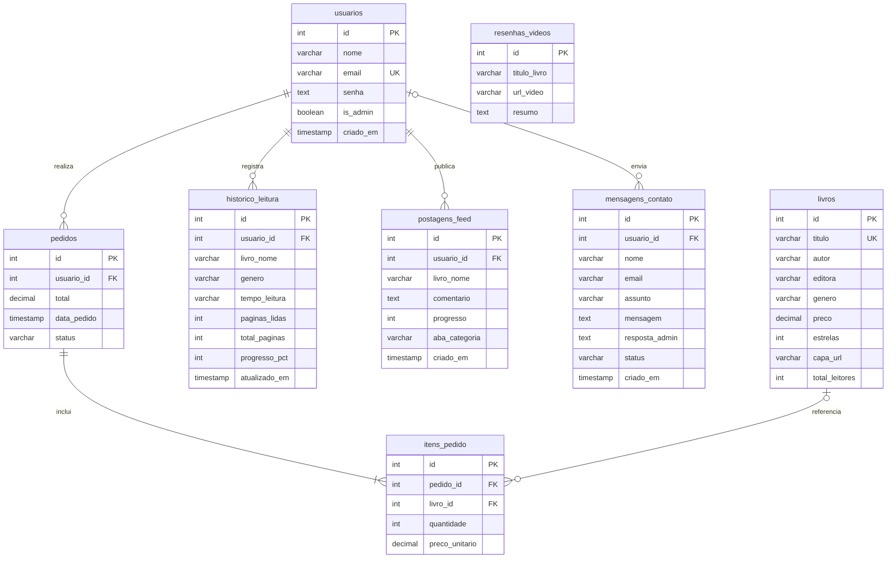
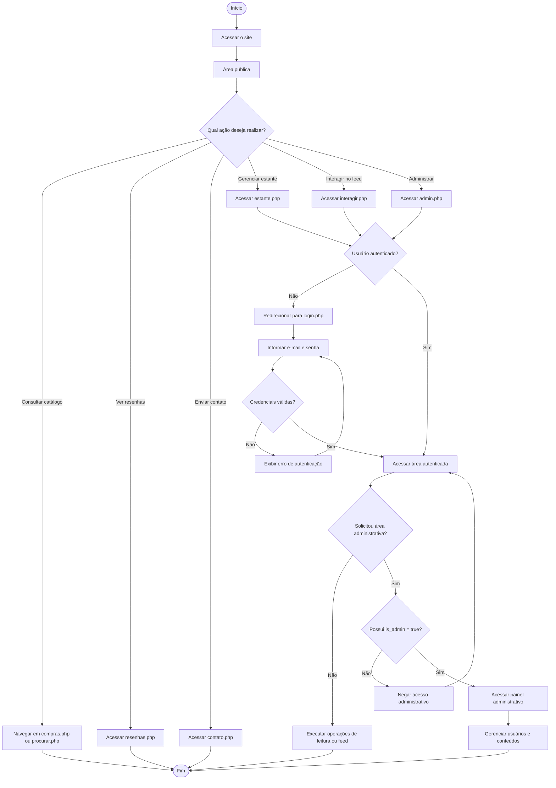

<h1 align="center"> A Toca de Leitura</h1>
<h3 align="center">Sistema de Gerenciamento e Comunidade Literária</h3>

<div align="center">


</div>

<hr>

##  Sobre o projeto

Desenvolvida em **PHP 8.2 ou superior**, com **PostgreSQL** como sistema gerenciador de banco de dados, **A Toca de Leitura** é uma aplicação web que integra diferentes etapas da jornada literária.

A plataforma conecta a descoberta e a aquisição de livros ao acompanhamento de hábitos de leitura, à organização de uma estante virtual e ao compartilhamento de experiências em uma comunidade de leitores.

O sistema implementa operações **CRUD** (Create, Read, Update e Delete), validação de entradas, gerenciamento de sessões e controle de acesso baseado em funções (**RBAC** — *Role-Based Access Control*).

###  Funcionalidades principais

- Cadastro, autenticação e gerenciamento de usuários.
- Catálogo de livros com pesquisa e filtros por gênero.
- Estante virtual com registro e acompanhamento do progresso de leitura.
- Feed comunitário para publicação de opiniões e experiências literárias.
- Área de resenhas em vídeo integradas ao YouTube.
- Carrinho de compras e registro de pedidos.
- Formulário de contato para dúvidas e sugestões.
- Painel administrativo para gerenciamento de usuários e moderação de conteúdos.

---

##  Índice

- [ Sobre o projeto](#-sobre-o-projeto)
- [1. Tecnologias Utilizadas](#1-tecnologias-utilizadas)
- [2. Como Executar o Projeto Localmente](#2-como-executar-o-projeto-localmente)
  - [2.1. Pré-Requisitos](#21-pré-requisitos)
  - [2.2. Instalação](#22-instalação)
    - [Passo 1: Clonar o Repositório](#passo-1-clonar-o-repositório)
    - [Passo 2: Configurar o Banco de Dados](#passo-2-configurar-o-banco-de-dados)
    - [Passo 3: Configurar a Conexão no PHP](#passo-3-configurar-a-conexão-no-php)
    - [Passo 4: Executar a Aplicação](#passo-4-executar-a-aplicação)
- [3. Estrutura de Diretórios](#3-estrutura-de-diretórios)
- [4. Especificação de Requisitos](#4-especificação-de-requisitos)
  - [4.1. Requisitos Funcionais](#41-requisitos-funcionais)
  - [4.2. Requisitos Não Funcionais](#42-requisitos-não-funcionais)
  - [4.3. Regras de Negócio](#43-regras-de-negócio)
- [5. Estrutura do Banco de Dados](#5-estrutura-do-banco-de-dados)
  - [Entidade: `usuarios`](#entidade-usuarios)
  - [Entidade: `livros`](#entidade-livros)
  - [Entidade: `historico_leitura`](#entidade-historico_leitura)
  - [Entidade: `postagens_feed`](#entidade-postagens_feed)
  - [Entidade: `resenhas_videos`](#entidade-resenhas_videos)
  - [Entidade: `mensagens_contato`](#entidade-mensagens_contato)
  - [Entidade: `pedidos`](#entidade-pedidos)
  - [Entidade: `itens_pedido`](#entidade-itens_pedido)
  - [Relacionamentos Principais](#relacionamentos-principais)
- [6. Diagramas](#6-diagramas)
  - [6.1. Diagrama Entidade-Relacionamento (MER)](#61-diagrama-entidade-relacionamento-mer)
  - [6.2. Fluxo de Processo](#62-fluxo-de-processo)
- [7. Protótipos](#7-protótipos)
  - [Baixa Fidelidade](#baixa-fidelidade)
  - [Alta Fidelidade](#alta-fidelidade)
- [8. Contribuindo](#8-contribuindo)
- [9. Contato & Suporte](#9-contato--suporte)

---

## 1. Tecnologias Utilizadas

| Tecnologia | Finalidade |
|------------|------------|
| **PHP 8.2+** | Desenvolvimento do back-end |
| **PostgreSQL 12+** | Persistência e gerenciamento dos dados |
| **HTML5** | Estrutura das páginas |
| **CSS3** | Estilização e responsividade |
| **PDO** | Comunicação entre PHP e PostgreSQL |
| **Git** | Controle de versão |

---

## 2. Como Executar o Projeto Localmente

Siga as etapas abaixo para configurar e executar a aplicação em um ambiente local.

### 2.1. Pré-Requisitos

- PHP 8.2 ou superior, com as extensões `pdo` e `pdo_pgsql` habilitadas.
- PostgreSQL instalado e em execução (porta padrão `5432`).
- Git instalado.
- Terminal, PowerShell ou Git Bash.

---

### 2.2. Instalação

#### Passo 1: Clonar o Repositório

Abra o terminal e execute:

```bash
# Clone o repositório
git clone https://github.com/beatrizbergamin003-afk/projetointegrador_tocaleitura.git

# Acesse a pasta do projeto
cd projetointegrador_tocaleitura
```

.

---

#### Passo 2: Configurar o Banco de Dados

O projeto utiliza o banco de dados `toca_leitura`. Toda a estrutura e os dados iniciais estão no arquivo `database/dumpTocaLeitura.sql`.

1. Acesse o PostgreSQL com o usuário padrão:

```bash
psql -U postgres 
```

2. Crie o banco de dados:

```sql
CREATE DATABASE toca_leitura
    WITH ENCODING = 'UTF8';
```

> [!WARNING]
> Se o banco já existir e você realmente quiser recriá-lo, faça backup dos dados e remova-o antes de executar o comando acima.

3. Crie o usuário da aplicação e transfira a propriedade do banco para ele:

```sql
CREATE USER raposa WITH PASSWORD 'raposa123';
ALTER DATABASE toca_leitura OWNER TO raposa;
\q
```

4. Na raiz do projeto, importe a estrutura e os dados iniciais:

```bash
psql -U raposa -h localhost -d toca_leitura -f database/dumptocaLeitura.sql
```


---

#### Passo 3: Configurar a Conexão no PHP

Abra o arquivo `config/db.php` e confira os parâmetros de conexão:

```php
<?php

$host     = 'localhost';
$port     = '5432';
$dbname   = 'toca_leitura';
$user     = 'raposa';
$password = 'raposa123'; // Altere para a senha definida no Passo 2

$dsn = "pgsql:host=$host;port=$port;dbname=$dbname";

$pdo = new PDO($dsn, $user, $password, [
    PDO::ATTR_ERRMODE            => PDO::ERRMODE_EXCEPTION,
    PDO::ATTR_DEFAULT_FETCH_MODE => PDO::FETCH_ASSOC,
]);
```

---

#### Passo 4: Executar a Aplicação

Na raiz do projeto, inicie o servidor embutido do PHP:

```bash
php -S localhost:8000
```

Em seguida, acesse no navegador:

```
http://localhost:8000/projetointegrador_tocaleitura/paginas_site/index.php
```

Para interromper o servidor, pressione `Ctrl + C` no terminal.

---

## 3. Estrutura de Diretórios

```
projetointegrador_tocaleitura
├── .gitignore
├── README.md
├── config
│   └── db.php
├── css
│   └── style.css
├── database
│   └── dumpTocaLeitura.sql
├── img_site
│   ├── logo_toca.png
│   └── logo.png
├── includes
│   ├── footer.php
│   └── header.php
└── paginas_site
    ├── admin.php
    ├── atualizar_status.php
    ├── cadastrar.php
    ├── carrinho.php
    ├── compras.php
    ├── contato.php
    ├── deletar_usuario.php
    ├── estante.php
    ├── index.php
    ├── interagir.php
    ├── login.php
    ├── logout.php
    ├── procurar.php
    └── resenhas.php
```

---

## 4. Especificação de Requisitos

### 4.1. Requisitos Funcionais

| ID | Título | Descrição | Prioridade | Feito? |
|----|--------|-----------|------------|:------:|
| **RF01** | Cadastro de Usuários | Permitir cadastro com nome completo, e-mail único e senha | Alta | ✅ |
| **RF02** | Autenticação | Validar credenciais e gerenciar sessões de usuários | Alta | ✅ |
| **RF03** | Exclusão de Conta | Permitir que o leitor exclua sua conta mediante confirmação | Alta | ✅ |
| **RF04** | Controle de Permissões | Diferenciar leitores e administradores por meio de `is_admin` | Alta | ✅ |
| **RF05** | Gerenciamento da Estante | Registrar livros, gêneros e metas de leitura | Alta | ✅ |
| **RF06** | Cálculo de Progresso | Calcular a porcentagem de leitura com base nas páginas lidas | Alta | ✅ |
| **RF07** | Divulgação no Feed | Oferecer publicação do progresso no feed comunitário | Média | ✅ |
| **RF08** | Remoção da Estante | Permitir a remoção de registros do histórico individual | Média | ✅ |
| **RF09** | Catálogo sem Duplicidades | Evitar a exibição duplicada de títulos no catálogo | Alta | ✅ |
| **RF10** | Filtro por Categoria | Filtrar livros por gênero literário | Alta | ✅ |
| **RF11** | Pesquisa de Obras | Buscar livros por título, autor ou editora | Alta | ✅ |
| **RF12** | Ranking de Leitura | Exibir os livros mais lidos quando não houver filtros ativos | Média | ✅ |
| **RF13** | Publicações no Feed | Permitir opiniões e organizar publicações por categorias | Alta | ✅ |
| **RF14** | Exclusão de Publicações | Permitir que leitores excluam suas próprias postagens | Média | ✅ |
| **RF15** | Resenhas em Vídeo | Incorporar vídeos do YouTube na página de resenhas | Média | ✅ |
| **RF16** | Contato | Permitir o envio de dúvidas e sugestões à equipe | Baixa | ✅ |
| **RF17** | Painel Administrativo | Disponibilizar uma interface de administração restrita | Alta | ✅ |
| **RF18** | Moderação | Permitir o gerenciamento de contas, permissões e publicações | Alta | ✅ |

### 4.2. Requisitos Não Funcionais

| ID | Título | Descrição | Prioridade | Feito? |
|----|--------|-----------|------------|:------:|
| **RNF01** | Linguagem | Back-end desenvolvido em PHP 8.2 ou superior | Alta | ✅ |
| **RNF02** | Banco de Dados | PostgreSQL com codificação UTF-8 | Alta | ✅ |
| **RNF03** | Senhas | Utilização de `password_hash()` para armazenamento seguro | Alta | ✅ |
| **RNF04** | Proteção contra SQL Injection | Utilização de consultas preparadas via PDO | Alta | ✅ |
| **RNF05** | Proteção contra XSS | Tratamento de dados exibidos em HTML com `htmlspecialchars()` | Alta | ✅ |
| **RNF06** | Sessões | Controle de acesso a áreas privadas por sessões no servidor | Alta | ✅ |
| **RNF07** | Integridade Referencial | Utilização de chaves estrangeiras e regras de exclusão | Alta | ✅ |
| **RNF08** | Responsividade | Interface adaptável a computadores e dispositivos móveis | Média | ✅ |
| **RNF09** | Codificação | Padronização dos arquivos de código e compatibilidade de caracteres | Alta | ✅ |

### 4.3. Regras de Negócio

| ID | Regra | Descrição |
|----|-------|-----------|
| **RN01** | Unicidade de E-mail | Não permitir mais de uma conta com o mesmo e-mail |
| **RN02** | Unicidade do Título | Impedir títulos duplicados no catálogo comercial (constraint `UNIQUE`) |
| **RN03** | Limite de Progresso | Calcular o progresso entre 0% e 100%, com base nas páginas lidas e no total de páginas |
| **RN04** | Exclusão em Cascata | A exclusão de um usuário remove os registros dependentes configurados com `ON DELETE CASCADE` |
| **RN05** | Moderação de Publicações | Leitores excluem suas próprias postagens; administradores podem moderar publicações de terceiros |
| **RN06** | Acesso Administrativo | Exigir sessão válida e privilégio administrativo para acessar `admin.php` |
| **RN07** | Proteção da Conta Administrativa Ativa | Impedir que o administrador remova a própria conta ou seus próprios privilégios pelo painel |
| **RN08** | Validação de Gêneros | Aceitar apenas gêneros permitidos pelas regras do sistema |
| **RN09** | Validação do Catálogo | Validar a existência de livros no catálogo quando a operação exigir essa referência |

---

## 5. Estrutura do Banco de Dados

O banco de dados organiza as informações de usuários, livros, históricos de leitura, publicações, resenhas, contatos e compras.

### Entidade: `usuarios`

Armazena as contas de leitores e administradores.

| Campo | Tipo | Restrições | Descrição |
|-------|------|-----------|-----------|
| `id` | INTEGER | PRIMARY KEY GENERATED ALWAYS AS IDENTITY | Identificador do usuário |
| `nome` | VARCHAR(255) | NOT NULL | Nome completo |
| `email` | VARCHAR(255) | UNIQUE NOT NULL | E-mail de autenticação |
| `senha` | TEXT | NOT NULL | Hash da senha (`password_hash()`) |
| `is_admin` | BOOLEAN | DEFAULT FALSE | Indica privilégio administrativo |
| `criado_em` | TIMESTAMP | DEFAULT CURRENT_TIMESTAMP | Data de criação da conta |

### Entidade: `livros`

Armazena o catálogo comercial de livros.

| Campo | Tipo | Restrições | Descrição |
|-------|------|-----------|-----------|
| `id` | INTEGER | PRIMARY KEY GENERATED ALWAYS AS IDENTITY | Identificador do livro |
| `titulo` | VARCHAR(255) | UNIQUE NOT NULL | Título da obra |
| `autor` | VARCHAR(255) | NOT NULL | Autor do livro |
| `editora` | VARCHAR(255) | | Editora responsável |
| `genero` | VARCHAR(100) | NOT NULL | Gênero literário |
| `preco` | DECIMAL(10,2) | DEFAULT 0.00 | Preço comercial |
| `estrelas` | INTEGER | DEFAULT 5 | Avaliação em estrelas |
| `capa_url` | VARCHAR(255) | | Caminho ou URL da capa |
| `total_leitores` | INTEGER | DEFAULT 0 | Quantidade acumulada de leitores |

### Entidade: `historico_leitura`

Registra a estante virtual e o progresso individual dos leitores.

| Campo | Tipo | Restrições | Descrição |
|-------|------|-----------|-----------|
| `id` | INTEGER | PRIMARY KEY GENERATED ALWAYS AS IDENTITY | Identificador do histórico |
| `usuario_id` | INTEGER | NOT NULL FK → `usuarios(id)` ON DELETE CASCADE | Usuário proprietário do registro |
| `livro_nome` | VARCHAR(255) | NOT NULL | Título do livro |
| `genero` | VARCHAR(100) | | Gênero literário |
| `tempo_leitura` | VARCHAR(255) | | Meta de tempo de leitura |
| `paginas_lidas` | INTEGER | DEFAULT 0 CHECK (paginas_lidas >= 0) | Páginas lidas |
| `total_paginas` | INTEGER | DEFAULT 0 CHECK (total_paginas >= 0) | Total de páginas |
| `progresso_pct` | INTEGER | DEFAULT 0 CHECK (progresso_pct BETWEEN 0 AND 100) | Progresso percentual |
| `atualizado_em` | TIMESTAMP | DEFAULT CURRENT_TIMESTAMP | Última atualização |

### Entidade: `postagens_feed`

Armazena as publicações da comunidade literária.

| Campo | Tipo | Restrições | Descrição |
|-------|------|-----------|-----------|
| `id` | INTEGER | PRIMARY KEY GENERATED ALWAYS AS IDENTITY | Identificador da publicação |
| `usuario_id` | INTEGER | NOT NULL FK → `usuarios(id)` | Autor da publicação |
| `livro_nome` | VARCHAR(255) | NOT NULL | Livro mencionado |
| `comentario` | TEXT | NOT NULL | Opinião ou avaliação |
| `progresso` | INTEGER | DEFAULT 0 | Progresso de leitura informado |
| `aba_categoria` | VARCHAR(50) | DEFAULT 'Geral' | Categoria de exibição |
| `criado_em` | TIMESTAMP | DEFAULT CURRENT_TIMESTAMP | Data da publicação |

### Entidade: `resenhas_videos`

Armazena informações sobre resenhas audiovisuais.

| Campo | Tipo | Restrições | Descrição |
|-------|------|-----------|-----------|
| `id` | INTEGER | PRIMARY KEY GENERATED ALWAYS AS IDENTITY | Identificador da resenha |
| `titulo_livro` | VARCHAR(255) | NOT NULL | Título da obra analisada |
| `url_video` | VARCHAR(255) | NOT NULL | Link do vídeo |
| `resumo` | TEXT | | Resumo da análise |

### Entidade: `mensagens_contato`

Registra dúvidas e sugestões enviadas à equipe.

| Campo | Tipo | Restrições | Descrição |
|-------|------|-----------|-----------|
| `id` | INTEGER | PRIMARY KEY GENERATED ALWAYS AS IDENTITY | Identificador da mensagem |
| `usuario_id` | INTEGER | FK → `usuarios(id)` ON DELETE SET NULL | Usuário associado à mensagem (opcional) |
| `nome` | VARCHAR(255) | NOT NULL | Nome do remetente |
| `email` | VARCHAR(255) | NOT NULL | E-mail para resposta |
| `assunto` | VARCHAR(255) | | Assunto da mensagem |
| `mensagem` | TEXT | NOT NULL | Conteúdo enviado |
| `resposta_admin` | TEXT | | Resposta administrativa |
| `status` | VARCHAR(50) | DEFAULT 'Pendente' | Estado do atendimento |
| `criado_em` | TIMESTAMP | DEFAULT CURRENT_TIMESTAMP | Data do envio |

### Entidade: `pedidos`

Armazena os pedidos e compras realizados na plataforma.

| Campo | Tipo | Restrições | Descrição |
|-------|------|-----------|-----------|
| `id` | INTEGER | PRIMARY KEY GENERATED ALWAYS AS IDENTITY | Identificador do pedido |
| `usuario_id` | INTEGER | NOT NULL FK → `usuarios(id)` | Cliente responsável |
| `total` | DECIMAL(10,2) | NOT NULL | Valor total do pedido |
| `data_pedido` | TIMESTAMP | DEFAULT CURRENT_TIMESTAMP | Data da compra |
| `status` | VARCHAR(50) | DEFAULT 'Concluido' | Situação do pedido |

### Entidade: `itens_pedido`

Armazena os itens vinculados a cada pedido.

| Campo | Tipo | Restrições | Descrição |
|-------|------|-----------|-----------|
| `id` | INTEGER | PRIMARY KEY GENERATED ALWAYS AS IDENTITY | Identificador do item |
| `pedido_id` | INTEGER | NOT NULL FK → `pedidos(id)` | Pedido associado |
| `livro_id` | INTEGER | FK → `livros(id)` | Livro adquirido |
| `quantidade` | INTEGER | NOT NULL CHECK (quantidade > 0) | Quantidade de exemplares |
| `preco_unitario` | DECIMAL(10,2) | NOT NULL | Preço unitário no momento da compra |

### Relacionamentos Principais

- Um usuário pode possuir vários registros de leitura.
- Um usuário pode publicar várias postagens.
- Um usuário pode realizar vários pedidos.
- Um usuário pode estar associado a várias mensagens de contato (opcional).
- Um pedido contém um ou mais itens.
- Um livro pode estar associado a vários itens de pedido.

> [!NOTE]
> O histórico de leitura e o feed utilizam `livro_nome` como referência textual, portanto não há chave estrangeira direta dessas entidades para `livros`. As regras de exclusão dependem das chaves estrangeiras definidas no banco.

---

## 6. Diagramas

### 6.1. Diagrama Entidade-Relacionamento (MER)



### 6.2. Fluxo de Processo

O fluxo a seguir ilustra a navegação geral, a autenticação e o controle de acesso administrativo.



---

## 7. Protótipos

Os protótipos foram concebidos para orientar a estrutura visual e a experiência de navegação da plataforma.

### Baixa Fidelidade

Desenvolvida no **Excalidraw**, apresenta a organização inicial das telas, os componentes principais e a disposição dos elementos da interface.

- [Veja aqui - Excalidraw](#) <!-- Substitua # pelo link público do Excalidraw -->

---


## 8. Contribuindo

Contribuições são bem-vindas! Para propor melhorias, corrigir problemas ou adicionar funcionalidades:

1. Faça um **Fork** do repositório
2. Clone seu fork e acesse a pasta do projeto
3. Crie uma branch para sua alteração (`git checkout -b feature/minha-feature`)
4. Faça as alterações e registre um commit (`git commit -m 'Adiciona minha funcionalidade'`)
5. Envie a branch para o seu repositório remoto (`git push origin feature/minha-feature`)
6. Abra um **Pull Request** para o repositório original, descrevendo as alterações e os motivos da contribuição

---

## 9. Contato & Suporte

- **Autor**: Beatriz Neves Bergamin
- **Email**: beatrizbergamin003@gmail.com
- **GitHub**: github.com/beatrizbergamin003-afk

---

<div align="center">

Desenvolvido com dedicação para incentivar a leitura e aproximar leitores. 📚

**A Toca de Leitura**

</div>